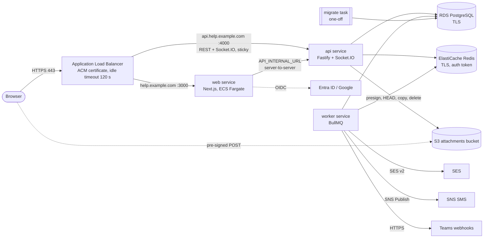

# Deploying Loons Help Desk to AWS

Phase 6 prepared the deployment; **nothing has been deployed**. This guide is the complete runbook for the person who will do it. It says precisely what was tested on a developer machine and what could only be written (section 1), so read that first.

Contents: [1 What was tested](#1-what-was-tested-and-what-was-not) · [2 Architecture](#2-architecture) · [3 AWS building blocks](#3-aws-building-blocks) · [4 The images](#4-the-images) · [5 Networking and security groups](#5-networking-and-security-groups) · [6 IAM](#6-iam) · [7 Environment variables](#7-environment-variables) · [8 Regions](#8-regions-and-service-availability) · [9 The S3 bucket](#9-the-s3-bucket) · [10 First deployment](#10-first-deployment-step-by-step) · [11 Upgrades](#11-upgrades) · [12 Rollback](#12-rollback) · [13 Scaling](#13-scaling-and-realtime) · [14 Backups](#14-backups-and-retention) · [15 Monitoring](#15-monitoring-and-alarms) · [16 Cost knobs](#16-cost-knobs) · [17 Go-live checklist](#17-go-live-checklist) · [18 Rehearsing locally](#18-rehearsing-the-production-images-locally) · [19 Troubleshooting](#19-troubleshooting)

---

## 1. What was tested, and what was not

**Tested on a developer machine (Windows 11, Docker Desktop, Node 24.21), and repeatable with `scripts/smoke-prod.sh`:**

- The three images (`web`, `api`, `worker`) and the one-off `migrate` image build from a clean checkout (`--no-cache`).
- Against the local Postgres, Redis and MinIO, started from the images with a production environment (`NODE_ENV=production`), read-only root file systems, no Linux capabilities and non-root users: the migrate image brings an **empty database** to the current schema (11 migrations), a second run is a no-op and `prisma migrate status` is clean; the production seed adds configuration and **no demo data** (even with `SEED_DEMO_DATA=true`); the containers become healthy; `/health` and `/health/live` answer; the web login page is served with the security headers (CSP, HSTS, framing, nosniff, referrer, permissions) and without the development staff password form; a Socket.IO connection without a token is refused; the processes stop cleanly on SIGTERM (exit code 0); the logs contain no secrets.
- The configuration check refuses every setting that is only acceptable on a developer machine (section 7), the SES, SNS and S3 clients are exercised against a fake AWS endpoint (region, signing, credential chain, request bodies, retries, errors), and a `rediss://` URL turns TLS on for every Redis connection (unit tests).
- The worker liveness mechanism (heartbeat file) and its health check.

**Could only be written, not tested (there is no AWS account to run against):**

- Everything that talks to a real AWS service: ECR, ECS/EKS, ALB, RDS, ElastiCache, S3 (real bucket CORS and lifecycle), SES, SNS, Secrets Manager, CloudWatch. The IAM policy (section 6) is derived from the code and from the AWS API documentation but has never been evaluated by IAM: apply it in a non-production account first and watch for `AccessDenied` in the API logs.
- TLS to RDS and ElastiCache against the real services. The connection-string handling was verified in unit tests and in `scripts/smoke-tls.sh` against a local PostgreSQL and Redis with TLS and a private CA (verification on, wrong CA and wrong host name refused), not against RDS or ElastiCache; the RDS CA files have to be downloaded and cut by you, and the single-certificate file that Prisma Migrate needs (it reads only the first certificate of its file) is a documented procedure that could not be tried against RDS (section 4.3).
- ALB WebSocket behaviour, stickiness and idle timeouts; Fargate sizing numbers (section 3 gives starting points based on measured container memory, not load tests); SES production access and SNS SMS delivery in the chosen region.
- Microsoft Entra ID and Google sign-in (they need real tenants / clients); the antivirus hook (`storage.scanHook` is still the no-op, see go-live).

---

## 2. Architecture



The same, as text:

```
Internet ──443──► ALB ──► web  (3 000) ──► api (4 000, internal address)
                    └──► api (4 000: REST + Socket.IO, sticky sessions when more than one task)
                          │  ▲
                          ▼  │ pub/sub: Socket.IO adapter, worker events
 worker (no port) ──► RDS PostgreSQL ◄── api        ElastiCache Redis ◄── api, worker
                      S3 ◄── api (server side) ◄── browser (pre-signed POST)
                      SES, SNS, Teams ◄── worker
 migrate (one-off task) ──► RDS PostgreSQL
```

Four containers, one repository:

| Service   | Image target                    | Port | Scales       | Notes                                                                                               |
| --------- | ------------------------------- | ---- | ------------ | --------------------------------------------------------------------------------------------------- |
| `web`     | `apps/web/Dockerfile`           | 3000 | horizontally | Stateless. Holds every secret of the sign-in flow. Calls the API server-to-server.                  |
| `api`     | `apps/api/Dockerfile` `api`     | 4000 | horizontally | REST + Socket.IO. More than one task needs the Redis adapter and sticky sessions (section 13).      |
| `worker`  | `apps/api/Dockerfile` `worker`  | none | horizontally | BullMQ consumers (email, SMS, Teams, escalation, SLA). Schedulers register themselves (section 13). |
| `migrate` | `apps/api/Dockerfile` `migrate` | none | one-off      | `prisma migrate deploy`, and the production seed. Runs to completion before a new release starts.   |

---

## 3. AWS building blocks

| Block           | What to create                                                                                                                                                                 | Notes                                                                                                                                                                                                                                                                                                                                                                                                                                                     |
| --------------- | ------------------------------------------------------------------------------------------------------------------------------------------------------------------------------ | --------------------------------------------------------------------------------------------------------------------------------------------------------------------------------------------------------------------------------------------------------------------------------------------------------------------------------------------------------------------------------------------------------------------------------------------------------- |
| Region          | `me-central-1` (UAE) or `me-south-1` (Bahrain)                                                                                                                                 | Section 8: check SES and SNS availability **before** choosing.                                                                                                                                                                                                                                                                                                                                                                                            |
| VPC             | 2 or 3 AZs; private subnets for tasks, database and cache; public subnets for the ALB                                                                                          | A NAT gateway (or per-AZ NAT) gives the tasks outbound HTTPS to Entra ID, Google, Teams and the AWS APIs. Add a **gateway endpoint for S3** (free) so attachment traffic skips the NAT.                                                                                                                                                                                                                                                                   |
| ALB             | One internet-facing ALB, HTTPS listener 443 with an ACM certificate, HTTP 80 redirecting to 443                                                                                | **Idle timeout 120 s** (Socket.IO pings every 25 s; the default 60 s also works, 120 s leaves room). Host rules: `help.example.com` → web target group, `api.help.example.com` → api target group, **with two rules above them that answer 403 for `/internal/*` and `/docs*` on the api host** (section 5). The api target group checks `/health/live`, not `/health` (section 4.4). Enable access logs to S3. Attach AWS WAF if the policy asks for it. |
| Compute         | **ECS on Fargate**, one service each for `web`, `api`, `worker` (EKS works the same; probes in section 4.4)                                                                    | Starting points; the idle memory measured in the rehearsal is in brackets (it grows with load): web 0.5 vCPU / 1 GB (about 120 MiB), api 0.5 vCPU / 1 GB (about 300 MiB), worker 0.5 vCPU / 1 GB (about 240 MiB). The sizes are guesses to be adjusted after watching real load, not results of a load test. `linux/amd64`; build for `linux/arm64` (Graviton) only if you build the images on arm64 too.                                                 |
| Database        | RDS PostgreSQL 16 (Multi-AZ for production), `rds.force_ssl=1`, storage encryption, automated backups with 14 days or more of retention (RDS allows 7-35), deletion protection | `db.t4g.medium` is a reasonable start. Parameter group: leave defaults. Connections: (API tasks + worker tasks) × `DATABASE_POOL_SIZE` must stay well below `max_connections` (section 13).                                                                                                                                                                                                                                                               |
| Cache           | ElastiCache for Redis 7 (replication group, Multi-AZ), **in-transit encryption on**, auth token or an ElastiCache user, **`maxmemory-policy noeviction`** (BullMQ requires it) | Single shard is enough. `cache.t4g.small` to start. **Cluster mode disabled** (the code connects to one primary endpoint and does not speak the cluster protocol). The client opens with RESP3 (`HELLO 3`, Redis 6 or newer) and falls back to RESP2 by itself if the engine refuses it (`lib/redis.ts`); not tested against ElastiCache.                                                                                                                 |
| Object storage  | One private S3 bucket, unversioned, with the lifecycle rule and CORS in section 9                                                                                              | Block all public access; default encryption SSE-S3.                                                                                                                                                                                                                                                                                                                                                                                                       |
| Email           | SES: verified domain identity with DKIM, a configuration set is optional                                                                                                       | Production access (leave the sandbox) before go-live.                                                                                                                                                                                                                                                                                                                                                                                                     |
| SMS             | SNS direct publish (no topic)                                                                                                                                                  | Raise the monthly SMS spend limit; leave the SMS sandbox; register a sender ID where the country needs one.                                                                                                                                                                                                                                                                                                                                               |
| Secrets         | Secrets Manager (or SSM Parameter Store SecureString)                                                                                                                          | Section 7 lists which variables are secrets.                                                                                                                                                                                                                                                                                                                                                                                                              |
| Logs and alarms | CloudWatch Logs (`awslogs` driver, one group per service, 30-90 days retention), alarms in section 15                                                                          | The apps log JSON to stdout.                                                                                                                                                                                                                                                                                                                                                                                                                              |
| Images          | One ECR repository per image (`loons/web`, `loons/api`, `loons/worker`, `loons/migrate`) with scan-on-push and a lifecycle policy that keeps the last N tags                   | **Immutable tags** (the git SHA or the release number), never `latest`.                                                                                                                                                                                                                                                                                                                                                                                   |
| DNS             | Route 53 (or your DNS): `help.example.com` and `api.help.example.com` → the ALB                                                                                                |                                                                                                                                                                                                                                                                                                                                                                                                                                                           |

---

## 4. The images

### 4.1 Build

From the repository root (the build context; `.dockerignore` is an allow-list, so a `.env` can never enter an image):

```bash
# The two RDS CA files of section 4.3: the global bundle ...
curl -fsSL -o deploy/certs/rds-global-bundle.pem https://truststore.pki.rds.amazonaws.com/global/global-bundle.pem
# ... and deploy/certs/rds-ca.pem, ONE certificate cut out of the regional bundle (procedure in section 4.3)

VERSION=2026.10.1   # your release id; used as the image tag
docker build -f apps/api/Dockerfile --target api     --build-arg REQUIRE_RDS_CA=true -t loons/api:$VERSION     .
docker build -f apps/api/Dockerfile --target worker  --build-arg REQUIRE_RDS_CA=true -t loons/worker:$VERSION  .
docker build -f apps/api/Dockerfile --target migrate --build-arg REQUIRE_RDS_CA=true -t loons/migrate:$VERSION .
docker build -f apps/web/Dockerfile \
  --build-arg NEXT_PUBLIC_API_URL=https://api.help.example.com \
  --build-arg NEXT_PUBLIC_UPLOAD_ORIGIN=https://loons-helpdesk-attachments.s3.me-central-1.amazonaws.com \
  -t loons/web:$VERSION .
```

Pushing (`aws ecr get-login-password | docker login …`, `docker tag`, `docker push`) is not scripted and has not been done.

| Image           | Final size on disk (measured)   | Contents                                                                                                                            |
| --------------- | ------------------------------- | ----------------------------------------------------------------------------------------------------------------------------------- |
| `web`           | about 400 MB                    | `node:24.21.0-bookworm-slim`, tini, the Next.js standalone server, static assets                                                    |
| `api`, `worker` | about 600 MB each (same layers) | Node + tini, the API sources and **production** dependencies only (no Prisma CLI, no dev dependencies), the generated Prisma client |
| `migrate`       | about 840 MB                    | Node + tini + OpenSSL, the Prisma CLI, tsx, the migrations and the seed. A one-off tool image; it is never started as a service     |

Base image: the official `node:24.21.0-bookworm-slim` (Node 24.16 or newer is required; the minor is pinned in the `NODE_VERSION` build argument of both Dockerfiles). pnpm 12.5.1 (from `packageManager`) is installed with `npm install --global`, not corepack. `pnpm install --frozen-lockfile` makes the dependency set reproducible. Every image runs as the unprivileged `node` user (uid 1000), starts under tini, sets `NODE_ENV=production` and works with a **read-only root file system**; the only writable path needed is `/tmp` (tsx's transform cache, the worker heartbeat). npm, npx and corepack are removed from the runtime images.

**Build arguments.** The only values baked into an image are the two `NEXT_PUBLIC_*` addresses of the web image (they are public: the browser calls them and they appear in the page's Content-Security-Policy). The web build **fails unless both are `https://` addresses of real hosts** (`apps/web/docker-check-build-args.ts`: plain http, localhost and loopback addresses are refused). `REHEARSAL_BUILD=true` lifts that rule and is passed only by `docker-compose.prod.yml` for the local rehearsal image: never pass it for an image that goes to AWS. `REQUIRE_RDS_CA` is a build switch, not a setting. Nothing secret is ever a build argument.

**Things to know about the build:**

- The API runs through `tsx` (`node --import tsx src/server.ts`), as it does in development: the repository has no compile step and the workspace packages export TypeScript. `tsx` is a production dependency of `@loons/api` for that reason. Start-up takes a few seconds longer than compiled JavaScript would.
- **A build needs outbound HTTPS to all of these** (a CI runner in a locked-down network needs every one, or mirrors of them): the base image `node:24.21.0-bookworm-slim` from Docker Hub (`registry-1.docker.io`, `auth.docker.io` and Docker's CDN) or from your own ECR mirror or pull-through cache; `deb.debian.org` (apt: OpenSSL and tini); `registry.npmjs.org` (pnpm itself is installed from npm, and every package); `binaries.prisma.sh` (the Prisma schema engine, downloaded while the `migrate` tree installs; a build step fails if it is missing); and, for the web image only, `fonts.googleapis.com` and `fonts.gstatic.com` (`next build` downloads the IBM Plex Sans Arabic font, `app/fonts.ts`, `next/font/google`, and self-hosts it in the output). The running containers make none of these requests. Vendoring the font file removes the Google dependency (carry-over in `docs/PHASE6_HANDOFF.md`; not decided yet).
- **Prisma's version check.** The Prisma CLI asks `checkpoint.prisma.io` whether a newer version exists. The `migrate` image sets `CHECKPOINT_DISABLE=1`, so the one-off task in a private subnet does not even try; the task needs no route to Prisma at all (the schema engine is already in the image).
- **Pin the base image by digest for go-live.** The `FROM node:24.21.0-bookworm-slim` lines follow the tag, which Docker re-publishes with security fixes. For a reproducible release: `docker pull node:24.21.0-bookworm-slim`, read the digest with `docker image inspect --format '{{index .RepoDigests 0}}' node:24.21.0-bookworm-slim`, and append `@sha256:<digest>` to the `FROM` lines of both Dockerfiles (refresh it when you raise `NODE_VERSION`). Not done in the repository, because a digest committed today would silently stop receiving patches.
- **Read-only root file system.** The web image writes nothing at run time: Next.js would only write `.next/cache` for `/_next/image` (the image optimiser), and the app uses no `next/image`.
- `@prisma/client` pulls the whole Prisma CLI in as an optional peer dependency even in a production-only install; `apps/api/scripts/prune-store.ts` removes it from the `api` and `worker` images and a build step fails if it is still there.
- The web image sets `HOSTNAME=0.0.0.0` so the Next.js server listens on every interface. **Kubernetes overrides `HOSTNAME` with the pod name**: set `HOSTNAME=0.0.0.0` explicitly in the pod spec (ECS does not touch it). The image also sets `NEXT_MANUAL_SIG_HANDLE=true` so that `docker-start.ts` (drain, then exit 0) handles SIGTERM instead of Next.js (which exits at once with code 143).

### 4.2 Image names and tags

Use the git commit SHA or the release number as the tag, identical for the four images of a release. The task definitions reference `…/loons/api:2026.10.1`; rolling back is re-deploying the previous tag.

### 4.3 The RDS CA bundle

The RDS certificate authority is not in Node's trust store, so a verified connection (`sslmode=verify-full`) needs two public files in `deploy/certs/` before you build: `rds-global-bundle.pem` (the whole global bundle, for the API and worker) and `rds-ca.pem` (**one** certificate, for Prisma Migrate: see "Making `rds-ca.pem`" below). The Dockerfile copies both to `/app/certs/` in the `api`, `worker` and `migrate` images, and `REQUIRE_RDS_CA=true` fails the build if either is missing. They are public and not committed, so each build picks up current ones.

The database URL then is (one secret, one line):

```
postgresql://<user>:<password>@<rds-endpoint>:5432/<db>?sslmode=verify-full&sslrootcert=/app/certs/rds-global-bundle.pem&sslcert=/app/certs/rds-ca.pem&sslaccept=strict
```

The two database clients read different parameters, which is why the URL has both sets (`scripts/smoke-tls.sh` proves it against a local PostgreSQL with TLS and a private CA):

- `sslmode=verify-full&sslrootcert=…` is what the **API and worker** (node-postgres) use: it verifies the certificate chain **and** the host name, and reads every certificate of the bundle. The configuration check **only accepts `sslmode=verify-full`**: node-postgres treats `require` and `verify-ca` as aliases of it today, but its next major version changes them to the weaker libpq meaning (encrypt without verifying).
- `sslcert=…&sslaccept=strict` is what **Prisma Migrate** (the schema engine, in the `migrate` image) uses. Prisma ignores `sslrootcert`, its default `sslaccept` accepts any certificate, and `sslcert` is the file it trusts as the root, **of which it reads only the first certificate**: that is why this is the single-certificate `rds-ca.pem` and not the bundle. Node-postgres ignores `sslaccept` (and uses `sslcert` as a client certificate it never needs to present, which is harmless). `<user>` and `<password>` must be **percent-encoded** (section 7).
- **Making `rds-ca.pem` (the primary path for the migrate task).** The file must hold exactly one certificate: the CA that signed your instance's server certificate chain. Do it once, and again whenever the instance's CA is rotated, on a machine with `curl`, `awk` and `openssl`:
  1. Find the CA your instance uses: `aws rds describe-db-instances --db-instance-identifier <id> --query 'DBInstances[0].CACertificateIdentifier'` (the console calls it "Certificate authority").
  2. Download the **regional** bundle and split it into one file per certificate (`n>0` skips anything before the first certificate):
     ```bash
     curl -fsSL -o /tmp/regional.pem https://truststore.pki.rds.amazonaws.com/me-central-1/me-central-1-bundle.pem
     awk '/BEGIN CERTIFICATE/{n++} n>0{print > sprintf("/tmp/rds-%02d.pem", n)}' /tmp/regional.pem
     for f in /tmp/rds-*.pem; do echo "== $f"; openssl x509 -in "$f" -noout -subject -issuer -enddate; done
     ```
  3. Choose the file that is the root of your instance's chain. Compare the subjects with the CA identifier of step 1. From a machine that can reach the database (a bastion, a one-off task), `openssl s_client -connect <rds-endpoint>:5432 -starttls postgres -showcerts </dev/null` prints the chain the server sends: pick the file whose subject is the **issuer of the last certificate the server sends** (the server's own root if it sends it). Copy it: `cp /tmp/rds-NN.pem deploy/certs/rds-ca.pem`.
  4. Check it: `openssl x509 -in deploy/certs/rds-ca.pem -noout -subject -issuer` (a root is self-signed: subject and issuer are equal) and `grep -c BEGIN deploy/certs/rds-ca.pem` prints `1`.

  **Honest caveat:** the mechanics (Prisma reads only the first certificate; one URL carries both settings) were verified with a private CA in `scripts/smoke-tls.sh`. Which RDS certificate is "the root of the chain" for your instance, and whether the server sends the root or only intermediates, could not be checked here (no AWS account). Run the migrate task once in a non-production account first. If it fails with `unable to get local issuer certificate`, the wrong certificate was chosen: repeat step 3 (try the other candidates of the same CA family). Last resort for the one-off migrate task only: replace `sslaccept=strict` by `sslaccept=accept_invalid_certs` in **that task's** copy of the secret (the connection stays encrypted, but the server certificate is not checked; the task runs inside the VPC, and the API and worker still verify with `verify-full`). The API and worker never need any of this.

- ElastiCache presents an Amazon-issued certificate that Node already trusts: `rediss://` needs no bundle (tested: `ioredis` verifies the server certificate and refuses an unknown CA).

### 4.4 Health checks

| Service  | Container check (set it in the task definition: **ECS ignores the `HEALTHCHECK` baked into an image**)                                                                             | Load balancer / orchestrator                                                                                                                                                                                               |
| -------- | ---------------------------------------------------------------------------------------------------------------------------------------------------------------------------------- | -------------------------------------------------------------------------------------------------------------------------------------------------------------------------------------------------------------------------- |
| `api`    | `["CMD", "node", "-e", "fetch('http://127.0.0.1:4000/health/live',{signal:AbortSignal.timeout(4000)}).then(r=>process.exit(r.ok?0:1),()=>process.exit(1))"]`                       | ALB target group **`/health/live`** (the process answers; no dependency is asked), healthy threshold 2, interval 15 s. Kubernetes: `livenessProbe` and `readinessProbe` both `/health/live`. **Not `/health`**: see below. |
| `web`    | `["CMD", "node", "-e", "fetch('http://127.0.0.1:3000/login',{signal:AbortSignal.timeout(4000),redirect:'manual'}).then(r=>process.exit(r.status===200?0:1),()=>process.exit(1))"]` | ALB target group `/login` (a real page: the server prints "Ready" **before** its configuration check ends, and a bad configuration then exits the process).                                                                |
| `worker` | `["CMD", "node", "src/healthcheck-worker.ts"]`                                                                                                                                     | No port. Kubernetes: `exec` probe with the same command.                                                                                                                                                                   |

All checks: interval 30 s, timeout 5 s, retries 3, **start period 60 s** (the API and worker compile TypeScript at start-up). The images carry the same commands as their `HEALTHCHECK` for plain Docker and Compose.

**Why the load balancer checks `/health/live` and not `/health`.** `/health` answers 503 whenever the database **or** Redis does not answer. If the target group checked it, a short RDS failover or ElastiCache blip would make **every** API task fail the check at the same moment: the ALB would have no healthy target (every request becomes a 503 until the dependency is back) and ECS, which replaces tasks the load balancer reports unhealthy, would start replacing all of them, so a few seconds of a dependency outage turns into a full outage plus a replace-everything storm that each new task (a minute of start-up) prolongs. Tasks that are only _waiting_ for a dependency should stay in service: they serve what they can (the web app shows errors, sockets reconnect) and recover on their own. Use `/health` for **monitoring**: a Route 53 health check or CloudWatch Synthetics canary on `https://api.help.example.com/health` with an alarm (section 15) tells a person that the database or Redis is down, without touching the tasks.

**How the worker proves it is alive.** The worker has no HTTP port. While its BullMQ consumers are running and it is not shutting down, it rewrites `WORKER_HEARTBEAT_FILE` (the worker image sets `/tmp/loons-worker-heartbeat`) every 10 s; `node src/healthcheck-worker.ts` exits 0 only if the file's timestamp is at most 35 s old. A blocked event loop, stopped consumers or a shutdown therefore fail the check and the task is replaced. Dependency outages (Redis, the database) are deliberately **not** part of it: a restart does not fix them. Watch them with the alarms in section 15.

`GET /health` returns `{"status":"ok","checks":{"db":"ok","redis":"ok"},"version":"<APP_VERSION>"}` with 503 when a check fails; it never contains connection strings or secrets (tested). `GET /health/live` is `{"status":"ok"}` with no dependency checks.

**Graceful stop.** `api` and `worker` close their connections on SIGTERM and exit 0 (the worker finishes active jobs, up to 30 s). The web container drains for 5 s and exits 0 (`apps/web/docker-start.ts`; Next.js's own handler exits at once and drops requests in flight). Set `stopTimeout` to 30 s in the task definitions and the ALB deregistration delay to 30 s or less.

### 4.5 Looking inside a running task

The images are built to be left alone: read-only root file system, no package manager, the unprivileged `node` user. **Prefer the logs, `/health` and a throw-away debug task over a shell in a production task.** A debug task is the same task definition run once (`aws ecs run-task`, same subnets and security groups) with the command overridden to `["sleep","3600"]` and ECS Exec enabled for that one task (`--enable-execute-command`); open a session with `aws ecs execute-command --cluster loons --task <task-arn> --container worker --interactive --command "/bin/sh"`, run what you need (`node src/healthcheck-worker.ts`, `node -e …`), and stop the task. The production service definitions do not enable ECS Exec.

ECS Exec has requirements of its own (taken from the ECS documentation; **none of it was tried here**, check the current "ECS Exec" page when you set it up):

- `enableExecuteCommand` on the service or the one-off task, and a Fargate platform version that supports it (1.4.0 or later).
- On the **task role** (not the execution role): `ssmmessages:CreateControlChannel`, `ssmmessages:CreateDataChannel`, `ssmmessages:OpenControlChannel`, `ssmmessages:OpenDataChannel` (the statement is in section 6), and network access from the task to the `ssmmessages` service (the NAT gateway, or an interface endpoint `com.amazonaws.<region>.ssmmessages`).
- **A read-only root file system conflicts with the SSM agent that ECS injects.** The agent needs writable directories of its own: the ECS documentation asks for writable volumes mounted at `/var/lib/amazon` and `/var/log/amazon` when `readonlyRootFilesystem` is true. Add them (ephemeral volumes, like `/tmp`) to the debug task definition only. If a session fails to start with an error saying the execute-command agent is not running, look at this first.
- The person who runs `aws ecs execute-command` needs `ecs:ExecuteCommand` on the cluster and the task.
- `initProcessEnabled`: AWS recommends it for ECS Exec so that the agent's child processes are reaped. Every image already runs under tini as PID 1, which reaps them; set `initProcessEnabled` only if you see defunct processes after sessions.

---

## 5. Networking and security groups

| Security group                  | Inbound                                                                                | Outbound                                                                                                                                                                       |
| ------------------------------- | -------------------------------------------------------------------------------------- | ------------------------------------------------------------------------------------------------------------------------------------------------------------------------------ |
| `sg-alb`                        | 443 from the internet (or only your office/VPN ranges), 80 for the redirect            | 3000 to `sg-web`, 4000 to `sg-api`                                                                                                                                             |
| `sg-web`                        | 3000 from `sg-alb`                                                                     | 4000 to `sg-api` (the `API_INTERNAL_URL` traffic), 443 to the internet via NAT (Entra ID, Google, the web app's server-side OIDC calls)                                        |
| `sg-api`                        | 4000 from `sg-alb` **and** from `sg-web`                                               | 5432 to `sg-db`, 6379 to `sg-cache`, 443 to AWS APIs (ECR, Logs, Secrets Manager at start; S3, SES, SNS at run time)                                                           |
| `sg-worker`                     | none                                                                                   | 5432 to `sg-db`, 6379 to `sg-cache`, 443 to the internet via NAT (ECR, Logs, Secrets Manager at start; SES, SNS, S3, Teams webhooks at run time)                               |
| `sg-migrate` (the one-off task) | none                                                                                   | 5432 to `sg-db`; **443 like the other tasks** (ECR, S3 for the image layers, CloudWatch Logs, Secrets Manager, via NAT or the VPC endpoints): without it the task cannot start |
| `sg-db`                         | 5432 from `sg-api`, `sg-worker`, `sg-migrate` (and an admin/bastion SG if you use one) | none                                                                                                                                                                           |
| `sg-cache`                      | 6379 from `sg-api`, `sg-worker`                                                        | none                                                                                                                                                                           |

**Every task needs outbound 443 at start**, whatever its security group allows for the application: ECR (image pull, plus the S3 gateway endpoint for the layers), CloudWatch Logs and Secrets Manager (and KMS or SSM Parameter Store if you inject from them). Give the private subnets a NAT gateway or interface endpoints (`ecr.api`, `ecr.dkr`, `logs`, `secretsmanager`, plus the S3 gateway endpoint); without them a Fargate task, the one-off `migrate` task included, fails to start before the application runs.

Notes: the web app reaches the API **server-side** through `API_INTERNAL_URL` (an internal address: Cloud Map / ECS Service Connect DNS such as `http://api.loons.internal:4000`, or an internal ALB), not through the public listener. The browser uses `NEXT_PUBLIC_API_URL` (the public API host) for REST and Socket.IO. Teams webhooks are outbound HTTPS to `*.webhook.office.com`, `*.logic.azure.com` or `*.environment.api.powerplatform.com` (the allowed-host list, `TEAMS_WEBHOOK_HOSTS`).

**Public listener rules (set them before the first user arrives).** The API serves two things that must not be reachable from the internet: the server-to-server routes `/internal/*` (they need the internal API key, but nothing outside the VPC has a reason to talk to them: the web app calls them through the internal address) and the Swagger UI and OpenAPI document `/docs*` (which list every route). `API_DOCS_ENABLED` is off in production by default, so the API already answers 404 for `/docs*`; the listener rules are the second layer, and the only protection for `/internal/*`. On the HTTPS listener add these two rules **above** the host rules, for the API host (and for any other host that forwards to the api target group):

| Priority | Condition                                          | Action             |
| -------- | -------------------------------------------------- | ------------------ |
| 1        | host `api.help.example.com` and path `/internal/*` | fixed response 403 |
| 2        | host `api.help.example.com` and path `/docs*`      | fixed response 403 |

`/docs*` also covers `/docs/json` and the UI's static files. With the CLI (shape not tested against a real ALB):

```bash
aws elbv2 create-rule --listener-arn <https-listener-arn> --priority 1 \
  --conditions Field=host-header,Values=api.help.example.com Field=path-pattern,Values='/internal/*' \
  --actions 'Type=fixed-response,FixedResponseConfig={StatusCode=403,ContentType=text/plain,MessageBody=Forbidden}'
```

(Repeat with priority 2 and `/docs*`.) Check from outside the VPC: `curl -i https://api.help.example.com/internal/auth/login` and `curl -i https://api.help.example.com/docs` must answer 403 from the load balancer, and `/health` must still answer (it reports only the status and the release version).

---

## 6. IAM

Three roles:

1. **Task execution role** (`AmazonECSTaskExecutionRolePolicy` plus the permission to read the secrets that are injected): pulls the images, writes the logs, and reads the secrets at task start.

   ```json
   {
     "Version": "2012-10-17",
     "Statement": [
       {
         "Sid": "ReadInjectedSecrets",
         "Effect": "Allow",
         "Action": ["secretsmanager:GetSecretValue"],
         "Resource": "arn:aws:secretsmanager:me-central-1:111122223333:secret:loons/prod/*"
       },
       {
         "Sid": "DecryptIfCustomerManagedKey",
         "Effect": "Allow",
         "Action": ["kms:Decrypt"],
         "Resource": "arn:aws:kms:me-central-1:111122223333:key/<key-id>"
       }
     ]
   }
   ```

   (Drop the KMS statement if the secrets use the default `aws/secretsmanager` key.) If you inject from **SSM Parameter Store** instead of (or as well as) Secrets Manager, add `ssm:GetParameters` (the plural: that is the call ECS makes) on the parameters, and `kms:Decrypt` for a SecureString that uses a customer-managed key:

   ```json
   {
     "Sid": "ReadInjectedParameters",
     "Effect": "Allow",
     "Action": ["ssm:GetParameters"],
     "Resource": "arn:aws:ssm:me-central-1:111122223333:parameter/loons/prod/*"
   }
   ```

2. **Task role of `api` and `worker`** (one role is enough; it is what the SDK's default credential chain picks up, so **no access keys exist anywhere**). Replace the account id, region, bucket and identity:

   ```json
   {
     "Version": "2012-10-17",
     "Statement": [
       {
         "Sid": "AttachmentsBucketList",
         "Effect": "Allow",
         "Action": "s3:ListBucket",
         "Resource": "arn:aws:s3:::loons-helpdesk-attachments"
       },
       {
         "Sid": "AttachmentsObjects",
         "Effect": "Allow",
         "Action": ["s3:GetObject", "s3:PutObject", "s3:DeleteObject"],
         "Resource": [
           "arn:aws:s3:::loons-helpdesk-attachments/attachments/*",
           "arn:aws:s3:::loons-helpdesk-attachments/files/*"
         ]
       },
       {
         "Sid": "SendEmailThroughSes",
         "Effect": "Allow",
         "Action": ["ses:SendEmail"],
         "Resource": "arn:aws:ses:me-central-1:111122223333:identity/loonsgroup.com"
       },
       {
         "Sid": "SendSmsThroughSns",
         "Effect": "Allow",
         "Action": "sns:Publish",
         "Resource": "*"
       }
     ]
   }
   ```

   Why each statement is there (derived from `src/lib/storage.ts` and the providers):
   - `s3:GetObject` covers `HeadObject`, the ranged read of the first bytes (file type check), the signed download URLs and the source of the server-side copy; `s3:PutObject` covers the copy into `files/` and the browser's pre-signed POST (which is signed with this role's credentials and is valid for `attachments/*` only); `s3:DeleteObject` removes the transient upload, rejected files and swept orphans.
   - **`s3:ListBucket` is required** although the code never lists: without it S3 answers **403 instead of 404** for a key that does not exist, and the attachment confirmation (`HEAD` of an upload that never arrived, the file-type read, the copy) would fail with a server error instead of a clean "upload not found". The earlier note in `PHASE2_HANDOFF.md` omitted it; this was found while reading the storage code for this phase.
   - `sns:Publish` to a phone number has no resource ARN, so the statement is `"*"`. To keep the role away from your topics, add an explicit `Deny` on `sns:Publish` for `arn:aws:sns:*:111122223333:*`.
   - ECS Exec (optional, section 4.5): add the four `ssmmessages` actions to the **task** role. They have no resource ARN:

     ```json
     {
       "Sid": "EcsExecChannels",
       "Effect": "Allow",
       "Action": [
         "ssmmessages:CreateControlChannel",
         "ssmmessages:CreateDataChannel",
         "ssmmessages:OpenControlChannel",
         "ssmmessages:OpenDataChannel"
       ],
       "Resource": "*"
     }
     ```

   - SES: if you use a configuration set, add its ARN to the resource list. If the bucket uses SSE-KMS instead of SSE-S3, also allow `kms:GenerateDataKey` and `kms:Decrypt` on the key.

3. **Task role of `web` and `migrate`**: none (they call no AWS API; the web app's only outbound calls are to the API and the OIDC providers; migrate talks to the database).

Humans who deploy need `ecr:*` on the repositories, `ecs:UpdateService` / `RunTask` / `RegisterTaskDefinition`, `iam:PassRole` for the two roles above, and read access to the secrets; keep that outside the task roles.

---

## 7. Environment variables

`.env.production.example` is the machine-checked source of this table: a test (`apps/api/src/env-docs.test.ts`) fails when a variable is added to the code but not documented there, documented there but unknown to the code, missing from this table or classified differently.

- **secret**: store in Secrets Manager (or SSM SecureString) and inject into the container as a secret (`secrets` in the ECS container definition, `valueFrom`), never as a plain `environment` value, never in an image or a build argument.
- **plain**: a normal task-definition environment value.
- **build**: baked into the web image at build time (`--build-arg`); changing it means a new web image.

A convenient layout is one JSON secret per concern (`loons/prod/database` with `DATABASE_URL`; `loons/prod/redis`; `loons/prod/auth` with `AUTH_SECRET`, `API_JWT_SECRET`, `INTERNAL_API_KEY`, the Google and Entra client secrets) and `valueFrom: <secret-arn>:<json-key>::` per variable. Generate the three signing secrets with `node -e "console.log(require('crypto').randomBytes(32).toString('base64url'))"`; they must be three **different** values of at least 32 characters, and the apps refuse a placeholder.

**Start-up refuses a configuration that is only acceptable on a laptop.** With `NODE_ENV=production` (the default when `NODE_ENV` is unset) and `DEPLOY_PROFILE=aws` (the default) the API and worker exit with a list of problems (variable names only, never values) unless:

| Rule                                                                                                                                                                                       | Variable(s)                                                                      |
| ------------------------------------------------------------------------------------------------------------------------------------------------------------------------------------------ | -------------------------------------------------------------------------------- |
| `APP_URL` is an `https://` URL and not localhost (nor any other loopback or unspecified address: 127.0.0.0/8, 0.0.0.0, `[::1]` ...); every `CORS_ORIGINS` entry is `https://` and the same | `APP_URL`, `CORS_ORIGINS`                                                        |
| `DATABASE_URL` has exactly one `sslmode` parameter, and it is `verify-full` (a repeated parameter is refused: node-postgres applies the last one)                                          | `DATABASE_URL`                                                                   |
| `DATABASE_URL` and `REDIS_URL` contain no `<...>` or `replace-me` placeholder, and their user name and password are percent-encoded (an unencoded `# ? / @ %` ... is refused)              | `DATABASE_URL`, `REDIS_URL`                                                      |
| `REDIS_URL` uses `rediss://`                                                                                                                                                               | `REDIS_URL`                                                                      |
| `SOCKET_REDIS_ADAPTER=true`, always (a service can be scaled past one API task at any time)                                                                                                | `SOCKET_REDIS_ADAPTER`                                                           |
| `TRUST_PROXY` is set: a hop count from 1 to 3 (1 = one ALB, 2 = CloudFront in front of it), or proxy CIDRs; not blank or `false`                                                           | `TRUST_PROXY`                                                                    |
| S3 has no custom endpoint, no path-style addressing and no static keys (the task role provides the credentials)                                                                            | `S3_ENDPOINT`, `S3_FORCE_PATH_STYLE`, `S3_ACCESS_KEY_ID`, `S3_SECRET_ACCESS_KEY` |
| `EMAIL_PROVIDER=ses`, `SMS_PROVIDER=sns`, `TEAMS_PROVIDER=webhook`                                                                                                                         | the three provider variables                                                     |
| `S3_REGION`, `SES_REGION`, `SNS_REGION` look like AWS regions                                                                                                                              | the three region variables                                                       |
| The signing secrets are real (not the `.env.example` placeholders), at least 32 characters and different from each other                                                                   | `API_JWT_SECRET`, `INTERNAL_API_KEY`, `AUTH_SECRET`                              |

The **web** server checks its own half at start-up (it exits with a `[config]` line): `AUTH_URL` is required, `https://` and not localhost (nor any loopback address) in production, `TRUSTED_PROXY_HOPS` is 1 to 3, the three secrets are real and different, `API_INTERNAL_URL` is set, the token lifetime is valid. `AUTH_DEV_STAFF_LOGIN` is ignored in production by both services.

`DEPLOY_PROFILE=rehearsal` switches the rules above off; it exists for `docker-compose.prod.yml` (section 18) and logs a warning at start-up (api, worker and web). **Never set it on AWS**, and on an ECS or Fargate runtime it cannot be: api, worker and web detect the markers ECS sets for every container (`ECS_CONTAINER_METADATA_URI_V4`, `ECS_CONTAINER_METADATA_URI`; Fargate and Lambda also set `AWS_EXECUTION_ENV`) and then refuse `DEPLOY_PROFILE=rehearsal` and any `NODE_ENV` other than `production`, in every environment. (A runtime that sets none of these markers, such as EKS or a plain EC2 host, relies on you: keep both values out of its configuration.)

**Credentials in connection URLs must be percent-encoded.** A raw `#`, `?`, `/`, `@` or `%` in the user name or password ends the credentials early or breaks the URL, and the apps refuse to start (the message names the variable, never the value). Encode each such character (`#` is `%23`, `?` is `%3F`, `/` is `%2F`, `@` is `%40`, `%` is `%25`, `:` is `%3A`, a space is `%20`), for example `node -e "console.log(encodeURIComponent(process.argv[1]))" 'p#ss/w@rd'`, or simply generate an **alphanumeric** password for the database user and for the ElastiCache auth token (RDS and ElastiCache both accept one), which needs no encoding. A `<` or `>` or `replace-me` left in `DATABASE_URL` or `REDIS_URL` is refused as an unfilled placeholder. Other variables are **not** checked for placeholders: the only values with a placeholder check are `API_JWT_SECRET`, `INTERNAL_API_KEY` and `AUTH_SECRET`.

**Do not put quotes around values** in the task definition, the secret or the console: they would become part of the value. `.env.production.example` is written without quotes for that reason (`EMAIL_FROM=Loons Support <support@loonsgroup.com>` is the whole value).

**The worker needs most of the API's variables.** `worker.ts` runs the same configuration check as the API, so it fails to start without `CORS_ORIGINS`, `TRUST_PROXY`, `SOCKET_REDIS_ADAPTER=true`, `API_JWT_SECRET`, `API_JWT_ISSUER`, `API_JWT_AUDIENCE` and `INTERNAL_API_KEY` even though it never serves a request; the table lists `worker` among their readers (a test removes each variable from a good configuration and fails if the worker could not start without one that is not listed).

## Environment variable reference

Grouped as in `.env.production.example`. "Read by" lists the services that need the variable (`migrate` = the migrate image: migrations and the seed).

### Mode

| Variable           | Read by                | Kind  | What it is / where the value comes from                                                                                                                                                                                                                                    |
| ------------------ | ---------------------- | ----- | -------------------------------------------------------------------------------------------------------------------------------------------------------------------------------------------------------------------------------------------------------------------------- |
| `NODE_ENV`         | web api worker migrate | plain | Always production on AWS (the images set it; never development). On an ECS / Fargate runtime any other value is refused at start-up.                                                                                                                                       |
| `DEPLOY_PROFILE`   | web api worker         | plain | aws = the strict production rules (HTTPS, TLS to database and Redis, IAM-role S3, SES / SNS / Teams providers, proxy trust). rehearsal switches them off and is for docker-compose.prod.yml only: NEVER set it on AWS (an ECS / Fargate runtime refuses it).               |
| `LOG_LEVEL`        | api worker             | plain | debug and trace log more detail; logs never contain personal data.                                                                                                                                                                                                         |
| `APP_VERSION`      | api worker             | plain | Reported by /health. Blank = the API package version; set it to the release tag.                                                                                                                                                                                           |
| `API_DOCS_ENABLED` | api                    | plain | Swagger UI and the OpenAPI document (/docs, /docs/json). Blank = off in production, on elsewhere. Keep it off on AWS: the document lists every route, /internal/* included. (The load balancer listener also blocks /docs* and /internal/*, docs/DEPLOYMENT.md section 5.) |

### URLs

| Variable                    | Read by    | Kind  | What it is / where the value comes from                                                                                                                            |
| --------------------------- | ---------- | ----- | ------------------------------------------------------------------------------------------------------------------------------------------------------------------ |
| `APP_URL`                   | api worker | plain | Public https URL of the web app (links in emails and Teams cards).                                                                                                 |
| `AUTH_URL`                  | web        | plain | Public https URL of the web app for Auth.js (OAuth callbacks); same as APP_URL.                                                                                    |
| `AUTH_TRUST_HOST`           | web        | plain | Required behind the load balancer: Auth.js trusts the forwarded host header.                                                                                       |
| `API_INTERNAL_URL`          | web        | plain | API base URL as seen from the web server: the internal address of the API service (service discovery / internal load balancer). Plain http inside the VPC is fine. |
| `NEXT_PUBLIC_API_URL`       | web        | build | API base URL as seen from the browser (REST + Socket.IO): the https address of the API on the load balancer. Also allowed in the web CSP connect-src.              |
| `NEXT_PUBLIC_UPLOAD_ORIGIN` | web        | build | Origin the browser uploads attachments to (pre-signed POST): `https://<bucket>.s3.<region>.amazonaws.com`                                                          |
| `DEV_ALLOWED_ORIGINS`       | web        | plain | Development servers only (`next dev`): hostnames or IPs other devices use to reach it. Leave empty in production; the standalone server ignores it.                |
| `CORS_ORIGINS`              | api worker | plain | Comma-separated https origins of the web app that may call the API from a browser. (The worker runs the same configuration check, so it needs the value too.)      |

### API server

| Variable                                | Read by    | Kind  | What it is / where the value comes from                                                                                                                                                                                                           |
| --------------------------------------- | ---------- | ----- | ------------------------------------------------------------------------------------------------------------------------------------------------------------------------------------------------------------------------------------------------- |
| `API_HOST`                              | api        | plain | Listen address inside the container.                                                                                                                                                                                                              |
| `API_PORT`                              | api        | plain | Listen port inside the container.                                                                                                                                                                                                                 |
| `PORT`                                  | web        | plain | Port and host of the Next.js standalone server (the web image sets both).                                                                                                                                                                         |
| `HOSTNAME`                              | web        | plain | Port and host of the Next.js standalone server (the web image sets both).                                                                                                                                                                         |
| `TRUST_PROXY`                           | api worker | plain | Proxies in front of the API whose X-Forwarded-For is trusted: 1 behind one load balancer, 2 with CloudFront in front of it (3 is the most accepted), or the VPC CIDR. Required in production (blank/false is refused). The worker only checks it. |
| `TRUSTED_PROXY_HOPS`                    | web        | plain | Proxies in front of the web app that append to X-Forwarded-For: 1 behind one load balancer, 2 with CloudFront in front of it (3 is the most accepted). 0 is refused in production.                                                                |
| `REALTIME_SOCKETS_PER_USER`             | api        | plain | Socket.IO limits per API instance (blank = the defaults shown).                                                                                                                                                                                   |
| `REALTIME_SOCKETS_PER_IP`               | api        | plain | Socket.IO limits per API instance (blank = the defaults shown).                                                                                                                                                                                   |
| `REALTIME_HANDSHAKES_PER_IP_BURST`      | api        | plain | Socket.IO limits per API instance (blank = the defaults shown).                                                                                                                                                                                   |
| `REALTIME_HANDSHAKES_PER_IP_PER_SECOND` | api        | plain | Socket.IO limits per API instance (blank = the defaults shown).                                                                                                                                                                                   |
| `REALTIME_PENDING_CONNECTIONS_PER_IP`   | api        | plain | Socket.IO limits per API instance (blank = the defaults shown).                                                                                                                                                                                   |

### Database (RDS PostgreSQL)

| Variable             | Read by            | Kind   | What it is / where the value comes from                                                                                                                                                                                                                                                                                                                                                                                                                                                                                                                                                                                                                                                                                                                                                                                  |
| -------------------- | ------------------ | ------ | ------------------------------------------------------------------------------------------------------------------------------------------------------------------------------------------------------------------------------------------------------------------------------------------------------------------------------------------------------------------------------------------------------------------------------------------------------------------------------------------------------------------------------------------------------------------------------------------------------------------------------------------------------------------------------------------------------------------------------------------------------------------------------------------------------------------------ |
| `DATABASE_URL`       | api worker migrate | secret | RDS endpoint with verified TLS; the whole URL is one secret (it holds the password). PERCENT-ENCODE the user name and password (# is %23, @ is %40, / is %2F, ? is %3F, % is %25, : is %3A) or use an alphanumeric password; the apps refuse an unencoded special character. Exactly one sslmode, and it must be verify-full. The CA files are added to the images from deploy/certs (docs/DEPLOYMENT.md, "The RDS CA bundle"): sslmode=verify-full and sslrootcert (the whole RDS bundle) are read by node-postgres (API, worker); sslcert and sslaccept=strict make Prisma Migrate verify the certificate too. Prisma ignores sslrootcert and reads only the FIRST certificate of sslcert, so rds-ca.pem is a file holding ONE certificate: the root that signed your instance's chain. Not tested against a real RDS. |
| `DATABASE_POOL_SIZE` | api worker         | plain  | Max pool connections per process. Keep (API tasks + worker tasks) x this well below the RDS max_connections.                                                                                                                                                                                                                                                                                                                                                                                                                                                                                                                                                                                                                                                                                                             |

### Redis (ElastiCache)

| Variable               | Read by    | Kind   | What it is / where the value comes from                                                                                                                                                                                                                                                                                                                                                                                                                         |
| ---------------------- | ---------- | ------ | --------------------------------------------------------------------------------------------------------------------------------------------------------------------------------------------------------------------------------------------------------------------------------------------------------------------------------------------------------------------------------------------------------------------------------------------------------------- |
| `REDIS_URL`            | api worker | secret | ElastiCache endpoint with in-transit encryption (rediss://) and the auth token or the user:password of an ElastiCache user; one secret. Percent-encode the password as for DATABASE_URL. Use a replication group with CLUSTER MODE DISABLED (one primary endpoint; the code does not speak the cluster protocol). The client opens with RESP3 (HELLO 3) and falls back to RESP2 itself if the engine refuses it (lib/redis.ts). Not tested against ElastiCache. |
| `SOCKET_REDIS_ADAPTER` | api worker | plain  | Socket.IO Redis adapter: must be true on AWS (refused otherwise): a service can be scaled past one API task at any time. The worker only checks it.                                                                                                                                                                                                                                                                                                             |
| `REDIS_KEY_PREFIX`     | api worker | plain  | Namespace of every Redis key, queue and channel. Blank = loons. Give every deployment that shares one Redis its own (staging, production).                                                                                                                                                                                                                                                                                                                      |

### Web authentication (Auth.js)

| Variable                         | Read by         | Kind   | What it is / where the value comes from                                                                                                                                                                                                |
| -------------------------------- | --------------- | ------ | -------------------------------------------------------------------------------------------------------------------------------------------------------------------------------------------------------------------------------------- |
| `AUTH_SECRET`                    | web             | secret | Encrypts the session cookie. Three different random values for AUTH_SECRET, API_JWT_SECRET and INTERNAL_API_KEY (>= 32 characters each). Generate with: node -e "console.log(require('crypto').randomBytes(32).toString('base64url'))" |
| `AUTH_SECRET_1`                  | web             | secret | Optional session-secret rotation: put the previous AUTH_SECRET here while rolling a new one out, then clear it.                                                                                                                        |
| `AUTH_SECRET_2`                  | web             | secret | Optional session-secret rotation: put the previous AUTH_SECRET here while rolling a new one out, then clear it.                                                                                                                        |
| `AUTH_SECRET_3`                  | web             | secret | Optional session-secret rotation: put the previous AUTH_SECRET here while rolling a new one out, then clear it.                                                                                                                        |
| `AUTH_GOOGLE_ID`                 | web             | secret | Google sign-in for clients. Leave both empty to hide the Google button.                                                                                                                                                                |
| `AUTH_GOOGLE_SECRET`             | web             | secret | Google sign-in for clients. Leave both empty to hide the Google button.                                                                                                                                                                |
| `AUTH_MICROSOFT_ENTRA_ID_ID`     | web             | secret | Microsoft Entra ID sign-in for staff. The issuer must be tenant-specific: `https://login.microsoftonline.com/<tenant-id-guid>/v2.0`                                                                                                    |
| `AUTH_MICROSOFT_ENTRA_ID_SECRET` | web             | secret | Microsoft Entra ID sign-in for staff. The issuer must be tenant-specific: `https://login.microsoftonline.com/<tenant-id-guid>/v2.0`                                                                                                    |
| `AUTH_MICROSOFT_ENTRA_ID_ISSUER` | web             | secret | Microsoft Entra ID sign-in for staff. The issuer must be tenant-specific: `https://login.microsoftonline.com/<tenant-id-guid>/v2.0`                                                                                                    |
| `STAFF_EMAIL_DOMAIN`             | web api migrate | plain  | Only this email domain is treated as Loons staff.                                                                                                                                                                                      |
| `AUTH_DEV_STAFF_LOGIN`           | web api         | plain  | Development-only staff password form. Ignored in production; leave false.                                                                                                                                                              |

### Web → API tokens

| Variable                | Read by        | Kind   | What it is / where the value comes from                                                                                                                  |
| ----------------------- | -------------- | ------ | -------------------------------------------------------------------------------------------------------------------------------------------------------- |
| `API_JWT_SECRET`        | web api worker | secret | HS256 secret shared by web (signs) and API (verifies) the short-lived tokens. (The worker runs the same configuration check, so it needs the value too.) |
| `API_JWT_ISSUER`        | web api worker | plain  | Token issuer and audience; the same in web and API (and checked by the worker).                                                                          |
| `API_JWT_AUDIENCE`      | web api worker | plain  | Token issuer and audience; the same in web and API (and checked by the worker).                                                                          |
| `API_TOKEN_TTL_SECONDS` | web api        | plain  | Access-token lifetime in seconds (60 to 3600).                                                                                                           |
| `INTERNAL_API_KEY`      | web api worker | secret | Server-to-server key for /internal/* routes (web server only; the worker only checks it).                                                                |

### File storage (S3)

| Variable                      | Read by    | Kind  | What it is / where the value comes from                                                                                                          |
| ----------------------------- | ---------- | ----- | ------------------------------------------------------------------------------------------------------------------------------------------------ |
| `S3_REGION`                   | api worker | plain | Region of the attachments bucket (me-central-1 or me-south-1).                                                                                   |
| `S3_BUCKET`                   | api worker | plain | Private, unversioned bucket with the lifecycle rule and CORS (docs/DEPLOYMENT.md).                                                               |
| `S3_ENDPOINT`                 | api worker | plain | AWS S3 only: leave these four empty / false. A custom endpoint or static keys are refused in production; the task role provides the credentials. |
| `S3_FORCE_PATH_STYLE`         | api worker | plain | AWS S3 only: leave these four empty / false. A custom endpoint or static keys are refused in production; the task role provides the credentials. |
| `S3_ACCESS_KEY_ID`            | api worker | plain | AWS S3 only: leave these four empty / false. A custom endpoint or static keys are refused in production; the task role provides the credentials. |
| `S3_SECRET_ACCESS_KEY`        | api worker | plain | AWS S3 only: leave these four empty / false. A custom endpoint or static keys are refused in production; the task role provides the credentials. |
| `UPLOAD_MAX_BYTES`            | api worker | plain | Largest single upload in bytes (blank = 26214400, 25 MiB).                                                                                       |
| `UPLOAD_DAILY_BYTES_PER_USER` | api        | plain | Upload budget per user over a rolling 24 hours, in bytes (blank = 2 GiB).                                                                        |

### Email (SES)

| Variable         | Read by    | Kind   | What it is / where the value comes from                                                                                                          |
| ---------------- | ---------- | ------ | ------------------------------------------------------------------------------------------------------------------------------------------------ |
| `EMAIL_PROVIDER` | api worker | plain  | ses on AWS (smtp is refused in production).                                                                                                      |
| `EMAIL_FROM`     | api worker | plain  | From address, WITHOUT quotes: Loons Support <support@loonsgroup.com>. Its domain (or the address) must be a verified SES identity in SES_REGION. |
| `SES_REGION`     | api worker | plain  | Region whose SES endpoint sends the mail. Use another region if SES is not offered in the main one (docs/DEPLOYMENT.md, "Regions").              |
| `SMTP_HOST`      | api worker | plain  | SMTP settings: only for EMAIL_PROVIDER=smtp (local development). Unused on AWS.                                                                  |
| `SMTP_PORT`      | api worker | plain  | SMTP settings: only for EMAIL_PROVIDER=smtp (local development). Unused on AWS.                                                                  |
| `SMTP_SECURE`    | api worker | plain  | SMTP settings: only for EMAIL_PROVIDER=smtp (local development). Unused on AWS.                                                                  |
| `SMTP_USER`      | api worker | plain  | SMTP settings: only for EMAIL_PROVIDER=smtp (local development). Unused on AWS.                                                                  |
| `SMTP_PASSWORD`  | api worker | secret | Unused on AWS.                                                                                                                                   |

### SMS (SNS)

| Variable                         | Read by    | Kind  | What it is / where the value comes from                                               |
| -------------------------------- | ---------- | ----- | ------------------------------------------------------------------------------------- |
| `SMS_PROVIDER`                   | api worker | plain | sns on AWS (console is refused in production).                                        |
| `SNS_REGION`                     | api worker | plain | Region whose SNS endpoint sends the text messages (may differ from the others).       |
| `SMS_SENDER_ID`                  | api worker | plain | Sender ID shown on the phone, where the destination country allows one. Blank = none. |
| `SMS_MAX_PER_RECIPIENT_PER_HOUR` | api worker | plain | Texts one phone number may receive per rolling hour (1 to 1000; blank = 20).          |

### Microsoft Teams

| Variable              | Read by    | Kind  | What it is / where the value comes from                                                                                                 |
| --------------------- | ---------- | ----- | --------------------------------------------------------------------------------------------------------------------------------------- |
| `TEAMS_PROVIDER`      | api worker | plain | webhook in production (console is refused). The webhook URLs themselves are stored per team in the database (Admin -> Teams), not here. |
| `TEAMS_WEBHOOK_HOSTS` | api worker | plain | Hosts a webhook URL may point at (host or *.domain). Blank = the Microsoft defaults.                                                    |
| `TEAMS_TIMEOUT_MS`    | api worker | plain | Webhook request timeout in ms (1000 to 60000).                                                                                          |

### Worker

| Variable                | Read by | Kind  | What it is / where the value comes from                                                                                                                                                                                                       |
| ----------------------- | ------- | ----- | --------------------------------------------------------------------------------------------------------------------------------------------------------------------------------------------------------------------------------------------- |
| `WORKER_SCHEDULERS`     | worker  | plain | true on the always-on worker service (1 or 2 tasks): every task with true upserts the same five schedulers (SLA scan, auto-close, digest, sweep, retention), never duplicates them. false on additional scale-out worker tasks. Blank = true. |
| `WORKER_HEARTBEAT_FILE` | worker  | plain | File the worker refreshes while healthy; the container health check reads it. The worker image sets /tmp/loons-worker-heartbeat.                                                                                                              |

### Production seed (one-off task of the migrate image)

| Variable             | Read by | Kind   | What it is / where the value comes from                                                                                                                  |
| -------------------- | ------- | ------ | -------------------------------------------------------------------------------------------------------------------------------------------------------- |
| `SEED_DEMO_DATA`     | migrate | plain  | Configuration only in production: teams, categories, SLA policies, templates. Demo data is never created in production, whatever this says.              |
| `SEED_DEMO_PASSWORD` | migrate | secret | Password of seeded demo users; unused in production (no demo users).                                                                                     |
| `SEED_ADMIN_EMAIL`   | migrate | plain  | Optional: creates the first SUPER_ADMIN (SSO only, no password). Must be an address on STAFF_EMAIL_DOMAIN; that person signs in with Microsoft Entra ID. |
| `SEED_ADMIN_NAME`    | migrate | plain  | Optional: creates the first SUPER_ADMIN (SSO only, no password). Must be an address on STAFF_EMAIL_DOMAIN; that person signs in with Microsoft Entra ID. |

---

## 8. Regions and service availability

Every AWS client takes its region from configuration, separately per service: `S3_REGION`, `SES_REGION`, `SNS_REGION`. Nothing in the code is region-specific, and there is no endpoint override on AWS.

The intended regions are `me-central-1` (UAE) or `me-south-1` (Bahrain). **Which AWS services exist in a region changes over time, and this was not verified from here**: check the _AWS Regional Services List_ for Amazon SES and Amazon SNS (SMS) in the region you pick, and for SMS also the supported destination countries and sender-ID rules for Qatar. If a service is missing in the main region, run the application there and point only that service elsewhere, for example `SES_REGION=eu-central-1` or `SNS_REGION=eu-west-1`. That is a documented choice, not code magic: the IAM policy then names the other region's identity ARN, the traffic goes over the internet/NAT to that region's endpoint, and your data-residency policy decides whether it is acceptable (an email and an SMS carry customer-facing text and a phone number). The S3 bucket, RDS and ElastiCache always stay in the main region.

---

## 9. The S3 bucket

Private, unversioned, SSE-S3 default encryption, **Block Public Access on**.

**Why unversioned:** on a versioned bucket the API's deletes under `files/` (rejected uploads) would leave noncurrent versions that the lifecycle below does not cover.

**Lifecycle** (browser uploads are transient: the pre-signed POST policy stays valid 15 minutes after `complete` deleted the object, so a re-POST can leave an unreferenced object under `attachments/`; confirmed files live under `files/` and must **not** expire). Save as `lifecycle.json`:

```json
{
  "Rules": [
    {
      "ID": "expire-browser-uploads",
      "Status": "Enabled",
      "Filter": { "Prefix": "attachments/" },
      "Expiration": { "Days": 1 },
      "NoncurrentVersionExpiration": { "NoncurrentDays": 1 }
    }
  ]
}
```

```bash
aws s3api put-bucket-lifecycle-configuration --bucket loons-helpdesk-attachments --lifecycle-configuration file://lifecycle.json
```

(Expiry runs on S3's schedule, so an orphan lives 24-48 hours. If you ever turn versioning on, add the `ExpiredObjectDeleteMarker` rule from `PHASE2_HANDOFF.md`.)

**CORS** (browsers upload straight to the bucket; the allowed origin is the web app's, `APP_URL`). Save as `cors.json` in the directory where you run the command below:

```json
{
  "CORSRules": [
    {
      "AllowedOrigins": ["https://help.example.com"],
      "AllowedMethods": ["POST"],
      "AllowedHeaders": ["*"],
      "ExposeHeaders": ["ETag"],
      "MaxAgeSeconds": 3000
    }
  ]
}
```

```bash
aws s3api put-bucket-cors --bucket loons-helpdesk-attachments --cors-configuration file://cors.json
```

Downloads are pre-signed `GET` URLs opened by navigation (no CORS needed). The web CSP `connect-src` allows `NEXT_PUBLIC_UPLOAD_ORIGIN`, which is why it is a build argument of the web image: it must equal `https://<bucket>.s3.<S3_REGION>.amazonaws.com`.

---

## 10. First deployment, step by step

Do it once in a **non-production AWS account** first; the order below is the order that works.

1. **Domain and certificates.** Pick the two host names (`help.example.com`, `api.help.example.com`), request an ACM certificate covering both in the main region, validate it by DNS.
2. **Network.** VPC, subnets, NAT, the S3 gateway endpoint, the security groups of section 5.
3. **Data stores.**
   - RDS PostgreSQL 16, `rds.force_ssl=1`, private subnets, `sg-db`. Create a dedicated user that owns the database, so migrations can create objects. Connect as the RDS master user (from a bastion or a one-off task inside the VPC) and run `CREATE USER loons_app WITH PASSWORD '…'; GRANT loons_app TO <master user>; CREATE DATABASE loons OWNER loons_app;`. **The `GRANT` is required on RDS**: the master user is not a superuser, and PostgreSQL lets a non-superuser create a database owned by another role only if it is a member of that role (otherwise `CREATE DATABASE … OWNER` fails with a `must be member of role` or `must be able to SET ROLE` error, depending on the PostgreSQL version). Give `loons_app` an alphanumeric password or percent-encode it in the URL (section 7).
   - ElastiCache Redis 7 replication group, in-transit encryption on, auth token set, `maxmemory-policy noeviction`, `sg-cache`.
   - The S3 bucket with the lifecycle and CORS of section 9.
4. **SES.** Verify the domain identity (DKIM CNAMEs) and the From address in `SES_REGION`; request production access. **SNS.** In `SNS_REGION`: raise the SMS monthly spend limit, leave the SMS sandbox (or verify the test numbers while testing), register a sender ID if Qatar requires one.
5. **Secrets.** Create the secrets of section 7 (database URL with the RDS CA parameters and a percent-encoded password, Redis URL with the auth token, the three signing secrets, Google and Entra client secrets). Store values without quotes.
6. **IAM roles** of section 6.
7. **Images.** Download the RDS CA bundle and make `deploy/certs/rds-ca.pem` (section 4.3), build the four images (section 4.1) and push them to ECR with the release tag.
8. **Task definitions** for `web`, `api`, `worker`, `migrate` (and `seed` = the migrate image with the command `prisma db seed`): environment from section 7, secrets by `valueFrom`, `readonlyRootFilesystem: true`, a writable `/tmp` (ECS: an ephemeral volume mounted at `/tmp`), `initProcessEnabled` not needed (tini is built in), `stopTimeout` 30, the container health checks of section 4.4, `awslogs` configuration. Do not enable ECS Exec on these definitions (section 4.5).
9. **Run the migration** (one-off task, the `migrate` task definition, same network and security group `sg-migrate`):

   ```bash
   aws ecs run-task --cluster loons --launch-type FARGATE --task-definition loons-migrate:1 \
     --network-configuration "awsvpcConfiguration={subnets=[subnet-aaa],securityGroups=[sg-migrate],assignPublicIp=DISABLED}"
   ```

   Wait for the task to stop with exit code 0 (`aws ecs describe-tasks … --query 'tasks[0].containers[0].exitCode'`); its log shows "All migrations have been successfully applied".

10. **Run the production seed** (the same image, command override `["prisma","db","seed"]`) with `NODE_ENV=production`, `STAFF_EMAIL_DOMAIN` and `SEED_ADMIN_EMAIL` (+ `SEED_ADMIN_NAME`): it creates the configuration (teams, categories, SLA policies, business hours and holidays, escalation rules, macros, email templates, help articles) and the first **SUPER_ADMIN** (single sign-on only, no password). It adds no demo data whatever `SEED_DEMO_DATA` says, and is safe to run again (create-only: it never overwrites edits).
11. **ALB.** Add the two blocking rules for `/internal/*` and `/docs*` on the API host (section 5). Target groups: `web` (port 3000, health check `/login`, success 200), `api` (port 4000, health check **`/health/live`** (not `/health`: section 4.4), **stickiness on** with a load-balancer cookie when running more than one task, deregistration delay 30 s). Listener rules by host header. Idle timeout 120 s.
12. **Services.** Create the ECS services: `worker` first, then `api`, then `web` (desired count 2 for web and api in production; 1 worker with `WORKER_SCHEDULERS=true`; see section 13). Deployment type rolling update, minimum healthy 100 %, maximum 200 %, circuit breaker with rollback enabled.
13. **DNS.** Point both host names at the ALB.
14. **Sign-in providers.** Register the redirect URIs `https://help.example.com/api/auth/callback/google` and `…/microsoft-entra-id` (section 17), set the client ids and secrets, redeploy `web`.
15. **Smoke-check production:** `https://api.help.example.com/health` returns 200 with the release version; the login page loads; sign in as the seeded admin through Microsoft Entra ID; open Admin and check the settings; raise a test ticket as a client in a test organisation, attach a file, watch the e-mail arrive.

---

## 11. Upgrades

1. Build and test the release (`pnpm exec turbo run typecheck lint test`; optionally `scripts/smoke-prod.sh` locally).
2. Build the four images with a **new tag** and push them.
3. **Migrate first, as a one-off task** of the new `migrate` image against production. The old version keeps serving meanwhile, which only holds if the new schema is still compatible with the previous release: write migrations that way (new nullable columns and new tables first). A migration that is not backwards compatible needs a two-step release (expand, then contract).
   - If the task fails, **nothing else is rolled**: the old tasks are untouched. Read the task log, fix forward (a new migration), or restore (section 12). `prisma migrate deploy` applies the pending migrations in order and stops at the first failure; Prisma records the failed migration in `_prisma_migrations` and refuses to continue until it is resolved (`prisma migrate resolve`, run from a shell in the migrate image; see Prisma's documentation on resolving failed migrations). Look at the database state before deciding between fixing forward and restoring.
   - **Never** run `migrate dev` or `migrate reset` against production. The migrate image only contains `migrate deploy` as its command, but the Prisma CLI inside it can run anything: do not.
4. Register new task definition revisions with the new tags and update the services in this order: **worker, api, web**. Rolling update with the circuit breaker. The API and web are stateless; sockets reconnect on their own (the client backs off and re-joins its rooms), and a worker finishes its active jobs on SIGTERM.
5. Verify `/health` shows the new version and run the production smoke checks.

Config-only changes (a setting, a secret rotation) are a new task-definition revision and a service update; rotating `AUTH_SECRET` without logging everyone out: put the old value in `AUTH_SECRET_1`, deploy, and clear it after the longest session lifetime.

---

## 12. Rollback

- **Application only** (the migration was backwards compatible, the usual case): update the three services to the previous task-definition revisions (previous image tag). No data is changed.
- **A bad migration**: stop writes (scale `api`, `web`, `worker` to 0), then either fix forward with a new migration or restore the RDS snapshot taken before the release (point-in-time restore to a new instance, switch the secret's endpoint, redeploy). Take a manual snapshot before every release that contains a migration (`aws rds create-db-snapshot`).
- Redis holds only queues, caches, rate-limit counters and sockets; it can be flushed in an emergency (jobs in flight are lost; the configuration version starts again from zero and open forms refetch once).
- Images are immutable and kept in ECR, so the previous release is always one `update-service` away. Keep at least the last five releases in the ECR lifecycle policy.

---

## 13. Scaling and realtime

- **Web** is stateless: scale on CPU (target 60 %) with a minimum of 2 tasks across 2 AZs.
- **API sockets.** Each API task holds its own Socket.IO connections; the limits (`REALTIME_*`) are **per task** (N tasks give N times the budget). With more than one API task:
  - `SOCKET_REDIS_ADAPTER=true` is mandatory (the configuration check enforces it on AWS whatever the task count: autoscaling or a console change can add API tasks at any time): events reach users connected to another task, and a role change closes the right sockets everywhere. A ticket update waits up to about 1 s for the other tasks' confirmation.
  - **Sticky sessions on the API target group** (ALB cookie `AWSALB`, 1 day). Socket.IO opens with HTTP long-polling requests before upgrading to a WebSocket, and those first requests must reach the same task. The browser client sends the cookie on these cross-origin requests (`withCredentials`, added in Phase 6; the API's CORS answers `credentials: true`). Sticky sessions are untested against a real ALB.
  - Idle timeout 120 s on the ALB; the Socket.IO ping interval is 25 s.
- **Worker.** BullMQ consumers scale horizontally; every task consumes all four queues, and a job runs once whichever task takes it. The repeatable jobs (SLA scan every minute, auto-close every 15 minutes, the P4 digest, the orphan-upload sweep, daily retention) are BullMQ job schedulers with fixed ids: **every worker that starts with `WORKER_SCHEDULERS=true` upserts the same five, never duplicates**, and one job per tick runs on whichever worker takes it. The supported layout is a small always-on worker service with `WORKER_SCHEDULERS=true` and desired count 1-2, and any additional scale-out workers with `WORKER_SCHEDULERS=false`. After flushing Redis, a worker with schedulers on must be (re)started to register them again.
- **Database connections.** Each API and worker task opens up to `DATABASE_POOL_SIZE` (default 10) connections. 2 web-facing API tasks + 2 workers = up to 40, well below `max_connections` of a `db.t4g.medium` (about 400). Use RDS Proxy only if you scale far beyond that.
- **Uploads** go from the browser to S3 and never pass through the API; the 25 MiB limit and the per-user 24-hour budget (`UPLOAD_DAILY_BYTES_PER_USER`) are enforced by the API (the budget is shared through Redis and **fails open while Redis is down**, as does the presign rate limit).

---

## 14. Backups and retention

- **RDS:** automated backups with 14-35 days retention (point-in-time recovery), a manual snapshot before every release with a migration, Multi-AZ for availability (it is not a backup). Test a restore into a scratch instance before go-live and note the time it takes.
- **S3:** keep the bucket **unversioned** (section 9); rely on the bucket's durability and on the database being the index of what exists. If a recovery requirement for deleted files appears, use S3 Replication or AWS Backup for S3 instead of versioning, and revisit the lifecycle rule.
- **Redis:** no backup needed (queues and caches only). Enable ElastiCache snapshots only if you want to keep queued jobs across a cache failure.
- **Application retention:** delivery logs and read notifications are deleted after 90 days by the worker's daily retention job; tickets, messages and the audit log are kept until you decide otherwise.
- **Logs:** CloudWatch Logs retention 30-90 days; ALB access logs to S3 with a lifecycle rule.

---

## 15. Monitoring and alarms

CloudWatch alarms to create (thresholds are starting points):

| Signal                                                                                                                                                         | Alarm                                                                       |
| -------------------------------------------------------------------------------------------------------------------------------------------------------------- | --------------------------------------------------------------------------- |
| ALB `HTTPCode_Target_5XX_Count` (web and api target groups)                                                                                                    | > 10 in 5 minutes                                                           |
| ALB `UnHealthyHostCount` / ECS running task count below desired                                                                                                | any, 2 consecutive periods                                                  |
| ALB `TargetResponseTime` p95 (api)                                                                                                                             | > 2 s for 10 minutes                                                        |
| ECS CPU / memory utilisation per service                                                                                                                       | > 80 % for 10 minutes                                                       |
| RDS `CPUUtilization`, `FreeStorageSpace`, `DatabaseConnections`, `FreeableMemory`                                                                              | > 80 % CPU; storage below 20 %; connections above 80 % of `max_connections` |
| ElastiCache `EngineCPUUtilization`, `DatabaseMemoryUsagePercentage`, `Evictions`                                                                               | > 80 %; > 75 %; any eviction (queues must never be evicted)                 |
| SES `Reputation.BounceRate`, `Reputation.ComplaintRate`                                                                                                        | bounce > 5 %, complaint > 0.1 %                                             |
| SNS SMS delivery failures / spend against the monthly limit                                                                                                    | failure rate; 80 % of the spend limit                                       |
| Synthetic check of `https://api.help.example.com/health` (database **and** Redis; Route 53 health check or CloudWatch Synthetics canary, not the target group) | fails 3 times in a row                                                      |
| Logs metric filter: the API logs `health check failing` (database or Redis down)                                                                               | any, 3 in 5 minutes                                                         |
| Logs metric filter: the worker logs `job moved to dead letter` when a job has used all its attempts                                                            | any, or a sustained burst                                                   |
| Worker task restarts (the health check failing)                                                                                                                | more than 2 in an hour                                                      |

The apps log JSON to stdout, one request per line with a request id, never personal data or secrets. Permanently failed jobs are also kept in a capped Redis list (`<REDIS_KEY_PREFIX>:bull:dead-letter`, newest first), and every e-mail, SMS and Teams delivery has a row with its status (`SENT`, `SKIPPED`, `FAILED`) in the `NotificationDelivery` table.

---

## 16. Cost knobs

Fargate task sizes and counts (web and api at 2, worker at 1, scale-out only on queue depth); RDS instance class and Multi-AZ; ElastiCache node size and replica count; NAT gateway count (one per AZ is resilient, one in total is cheaper) and the S3 gateway endpoint; CloudWatch Logs retention and the `LOG_LEVEL` (`info` is the default; `debug` multiplies volume); SES and SNS volumes (`SMS_MAX_PER_RECIPIENT_PER_HOUR` caps texts per number; the SMS monthly spend limit caps the account); S3 storage (the `attachments/` lifecycle keeps transient uploads to a day) and `UPLOAD_MAX_BYTES` / `UPLOAD_DAILY_BYTES_PER_USER`; ALB LCUs (long-lived sockets count as connections); data transfer across AZs (keep tasks and cache in the same AZs where possible).

---

## 17. Go-live checklist

Infrastructure

- [ ] ACM certificate issued; DNS for `help.…` and `api.help.…` points at the ALB; HTTP redirects to HTTPS; HSTS is sent by the web app (verify in the browser).
- [ ] RDS is Multi-AZ, encrypted, `rds.force_ssl=1`; the CA bundle is in the images and the API connects with `sslmode=verify-full` (check the API log for a successful `/health`).
- [ ] ElastiCache has in-transit encryption and `noeviction`; `/health` shows `redis: ok`.
- [ ] The bucket is private, unversioned, has the lifecycle and CORS of section 9; an upload and a download work from the browser.
- [ ] Security groups match section 5; no database or cache port is reachable from the internet.
- [ ] The listener rules of section 5 answer 403 for `/internal/*` and `/docs*` on the API host (checked with `curl` from outside the VPC), and the api target group checks `/health/live`.
- [ ] All secrets are in Secrets Manager; no secret appears in a task definition's plain environment, an image, or a build argument; `DEPLOY_PROFILE` is not set to `rehearsal`.
- [ ] CloudWatch alarms of section 15 exist and notify a person; log retention is set.
- [ ] A manual RDS snapshot exists and a restore has been rehearsed.

Sign-in and policy

- [ ] **Microsoft Entra ID** app registration: redirect URI `https://help.example.com/api/auth/callback/microsoft-entra-id`, tenant-specific issuer `https://login.microsoftonline.com/<tenant-guid>/v2.0` (the app refuses `common`/`organizations`/`consumers`), client secret in Secrets Manager (and a calendar reminder for its expiry), the seeded `SEED_ADMIN_EMAIL` can sign in.
- [ ] **MFA through Conditional Access** on that application in Entra ID: staff sign in only through Entra ID (the password form does not exist in production), so MFA is enforced there, not in this app (the user table has MFA-ready columns but no local factor).
- [ ] **Google OAuth** client (clients' sign-in): authorised redirect URI `https://help.example.com/api/auth/callback/google`, consent screen published (not "testing"), client secret in Secrets Manager. Leave both variables empty to hide the button.
- [ ] **SES production access** granted; DKIM verified; SPF/DMARC records published for the From domain; the bounce/complaint alarms exist.
- [ ] **SNS SMS**: monthly spend limit raised, out of the SMS sandbox, sender ID registered if required, a real P1 test reached a real phone.
- [ ] **Virus scanning.** `storage.scanHook` is still the no-op hook (every file is treated as clean after the file-type check). Plug in ClamAV or GuardDuty Malware Protection for S3 **before** go-live if clients may upload files.
- [ ] **Teams**: each team's incoming-webhook / Power Automate URL is configured in Admin → Teams and a test card arrived.
- [ ] Business hours, holidays, SLA policies, escalation chain and e-mail templates reviewed in the Admin panel (the production seed creates defaults only).
- [ ] Privacy/legal: data residency choice for SES/SNS (section 8) approved; retention periods agreed.

Release hygiene

- [ ] Images scanned (ECR scan on push); the base image and Node patch version are current (`NODE_VERSION`), and the base image is pinned by digest in the `FROM` lines (section 4.1).
- [ ] `/health` reports the release version after every deployment; rollback tested once (section 12).
- [ ] `docker-compose.prod.yml` / `scripts/smoke-prod.sh` still pass for this release.

---

## 18. Rehearsing the production images locally

`docker-compose.prod.yml` + `scripts/smoke-prod.sh` run the exact images against the local Postgres, Redis, MinIO and Mailpit with a production environment (`DEPLOY_PROFILE=rehearsal` switches the AWS-only rules off, so the services can be plain HTTP and MinIO). It uses its own database, bucket and Redis prefix, and removes all of it:

```bash
docker compose up -d                 # the local services
scripts/smoke-prod.sh --clean        # build from scratch, rehearse, check, tear down (about 3-5 minutes)
scripts/smoke-prod.sh --no-build     # reuse the images built before
```

Host ports 3100 (web) and 4100 (api) are used so a development stack on 3000/4000 can keep running. The script prints each check and a timing summary, and exits non-zero on any failure. What it checks is listed in section 1.

---

## 19. Troubleshooting

- **The API/worker exits at start with `Invalid environment configuration`.** The message lists variable names. Section 7 explains each production rule. The web app prints `[config] …` and exits when its own check fails; the web server prints "Ready" before that check ends, so look at the log, not only at the status.
- **`error: self-signed certificate in certificate chain` / `unable to verify the first certificate`** connecting to RDS: the CA bundle is missing from the image (build with `REQUIRE_RDS_CA=true`) or `sslrootcert` points elsewhere.
- **Prisma Migrate: `unable to get local issuer certificate`**: `rds-ca.pem` is not the root of your instance's chain (section 4.3, "Making `rds-ca.pem`"), or it holds more than one certificate.
- **The API, worker or web exits at start naming `DATABASE_URL` or `REDIS_URL` ("percent-encoded" or "placeholder")**: encode the user name and password, or fill in the `<...>` part (section 7). The message never prints the value.
- **The API, worker or web exits at start with "an AWS runtime was detected"**: `NODE_ENV` is not `production` or `DEPLOY_PROFILE` is `rehearsal` in a task definition (section 7).
- **Prisma Migrate: `Can't write to …/@prisma/engines`** means the schema-engine binary for this OS is missing from the migrate image: rebuild the image (the build installs OpenSSL before Prisma so the Debian 12 binary is fetched).
- **Attachment confirmation fails with a server error / 403 from S3:** the task role lacks `s3:ListBucket` (section 6).
- **Sockets connect once and then loop on "Session ID unknown" / 400:** more than one API task without sticky sessions on the target group (section 13).
- **Users do not see live updates after the second API task started:** `SOCKET_REDIS_ADAPTER` is not true (the configuration check refuses it on AWS, so this means the check was bypassed with `DEPLOY_PROFILE=rehearsal`).
- **No e-mail/SMS:** look for `FAILED` / `SKIPPED` rows in the `NotificationDelivery` table and for `job moved to dead letter` in the worker log; SES in the sandbox only sends to verified addresses; SNS in the SMS sandbox only to verified numbers; the SES identity must exist in `SES_REGION`.
- **The worker task keeps restarting:** its health check reads the heartbeat file; run `node src/healthcheck-worker.ts` in a debug task (section 4.5) and read the log for `worker ready`. Check that `/tmp` is writable (the root file system is read-only).
- **A task keeps being replaced right after start:** the start period is too short; the API and worker need 20-40 s to compile and connect (use a start period of 60 s).
